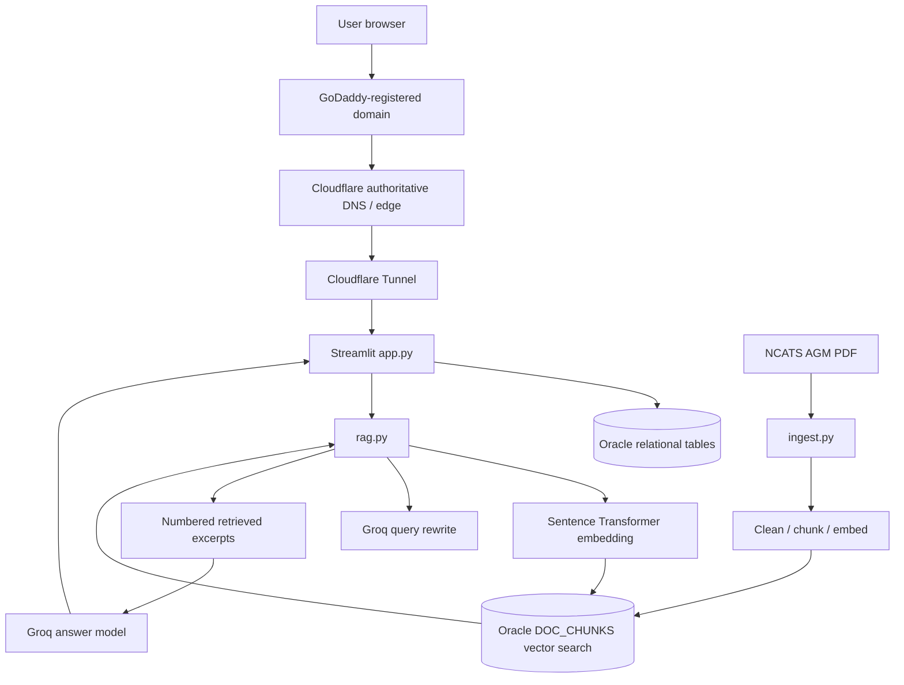

# Ellipsis Chat — Technical Implementation Documentation

Ellipsis Chat is a specialised conversational interface focused on answering scientific assay-relevant questions using retrieved passages from the **NCATS Assay Guidance Manual**. Unlike an unconstrained chatbot, the RAG instructions require supported statements and numbered citations.

**Solution Motivation:** Let users explore a long scientific manual through a conversational interface while retaining traceability to sections and page ranges. 

**Knowledge Source:** [NCATS Assay Guidance Manual](https://www.ncbi.nlm.nih.gov/books/NBK53196/)

**Scope:** An implementation document—not a hosted source.

## Application showcase

### Login screen

*Figure 1. Split-screen login form with masked password input and illustration (Screenshot).*

### Main chat interface

*Figure 2. Dark Streamlit chat interface with recent conversations and New chat action (Screenshot).*

### RAG answer and citations

*Figure 3. “Hill slope in bioassay” response with numbered in-text references and manual page references (Screenshot). The screenshot demonstrates rendered citations.*

## System at a glance

| Layer | Configuration / implementation |
|---|---|
| Interface | Python Streamlit, custom CSS, sidebar conversation management |
| Authentication | `app_users` Oracle table, PBKDF2-SHA256 verification, signed session token |
| Backend storage | Oracle tables for users, conversations, messages, source documents, chunks, citations |
| Vector data | `VECTOR(384, FLOAT32)` and cosine vector distance |
| Embeddings | `sentence-transformers/all-MiniLM-L12-v2` |
| Knowledge source | NCATS Assay Guidance Manual PDFs |
| LLM access | Groq SDK; Qwen for responses and GPT-OSS for query rewriting |
| Domain | Registered with GoDaddy |
| DNS | Records copied from GoDaddy to Cloudflare *before* nameserver change |
| Public access | Cloudflare Tunnel connects public hostname to locally running Streamlit service |

## Architecture

## Documentation index

1. [Architecture](docs/01-SYSTEM-ARCHITECTURE.md)
2. [Oracle 26ai setup](docs/02-ORACLE-26AI-SETUP.md)
3. [Database schema](docs/03-DATABASE-SCHEMA.md)
4. [PDF ingestion and embeddings](docs/04-PDF-INGESTION-AND-EMBEDDINGS.md)
5. [Vector search and RAG](docs/05-VECTOR-SEARCH-AND-RAG.md)
6. [Streamlit interface](docs/06-STREAMLIT-UI.md)
7. [Groq integration](docs/07-GROQ-LLM-INTEGRATION.md)
8. [GoDaddy → Cloudflare DNS migration](docs/08-GODADDY-CLOUDFLARE-DNS.md)
9. [Cloudflare Tunnel](docs/09-CLOUDFLARE-TUNNEL.md)
10. [Challenges, limitations and lessons](docs/10-CHALLENGES-AND-LEARNINGS.md)

