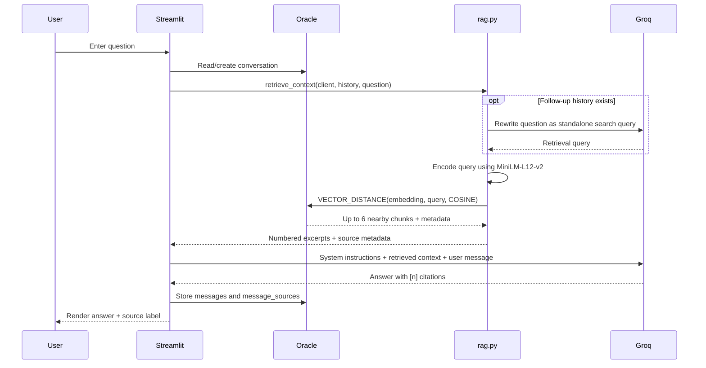

# System architecture

## Online request flow

## Offline document preparation

PDF → PyMuPDF text blocks → cleaned paragraphs → bookmark-derived section paths → overlapping chunks → 384-dimension embeddings → `DOCUMENTS` and `DOC_CHUNKS`.

## Infrastructure boundary

A GoDaddy-registered domain (heyellipsis.in) is delegated to Cloudflare DNS and Cloudflare Tunnel exposes the local Streamlit service. 

## Persistence

`APP_USERS → CONVERSATIONS → MESSAGES → MESSAGE_SOURCES ← DOC_CHUNKS ← DOCUMENTS`. See [schema chapter](04-DATABASE-SCHEMA.md).
