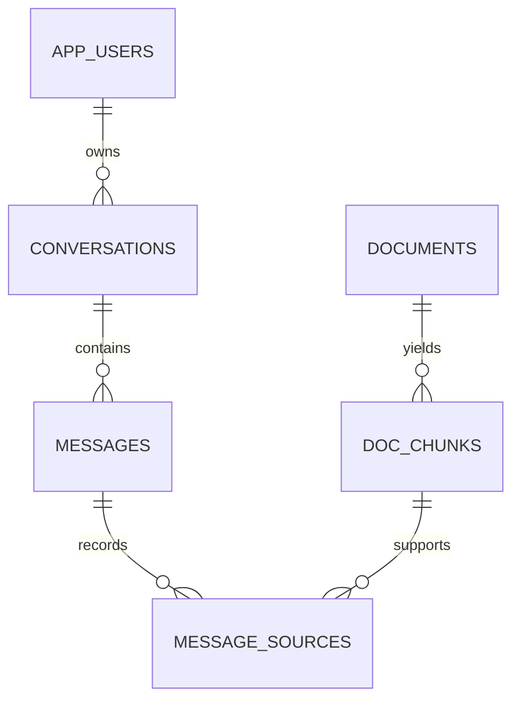

# Database schema

Six tables have been created under the 'sandbox' schema. The reproducible, redacted script is at [`database/schema.sql`](../database/schema.sql).

| Table | Key columns | Use |
|---|---|---|
| `APP_USERS` | `id`, `email`, `password_hash`, `created_at` | Login records |
| `CONVERSATIONS` | `id`, `user_id`, `title`, `created_at` | Per-user threads |
| `MESSAGES` | `id`, `conversation_id`, `role`, `content CLOB` | Stored turns |
| `DOCUMENTS` | `doc_id`, `file_name`, `file_sha256`, `page_count` | Source PDF inventory |
| `DOC_CHUNKS` | `chunk_id`, `doc_id`, `section`, `page_start`, `page_end`, `embedding VECTOR(384, FLOAT32)` | Source text + embeddings |
| `MESSAGE_SOURCES` | `message_id`, `rank_no`, `chunk_id`, `distance` | Trace from answer to retrieved chunks |

**Integrity:** primary and foreign keys, `ON DELETE CASCADE`, message-role check and unique `(doc_id, chunk_no)`. `message_sources.rank_no` maps to displayed `[1]`, `[2]` citations. `distance` records retrieval-time cosine distance.

**Vector index status:** The IVF and HNSW index set aside since exact scanning is considered viable for the reported small corpus; query code uses `FETCH APPROX FIRST … ROWS ONLY`.
