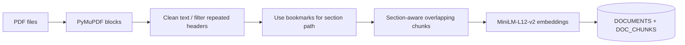

# PDF ingestion and embeddings

## Ingestion pipeline

| Setting | Value |
|---|---|
| Embedding model | `sentence-transformers/all-MiniLM-L12-v2` |
| Dimensions | 384 |
| `MAX_SEQ_TOKENS` | 256 |
| `TARGET_CHARS` | 800 |
| `MAX_CHARS` | 1000 |
| `OVERLAP_CHARS` | 150 |
| `MIN_CHARS` | 40 |
| Embedding batch size | 32 |
| Header/footer zone | 7% at top/bottom of each page |
| Repeat threshold | More than 30% of pages |

Cleaning removes soft hyphens, recombines line-break hyphenations, discards repeated running headers/footers and standalone page numbers. The ingest.py script uses PDF bookmarks for chapter/section hierarchy; the filename serves as a fallback if no bookmarks exist. Chunks store section paths in the text to improve matching and page spans for citation display.

The script SHA-256 hashes files to skip unchanged ingestions or replace changed versions. `--force` reloads even identical files. Embeddings are normalized before persistence and stored as FLOAT32 vectors in Oracle.

**Limitations:** Text extraction was embedded, while charts, formulas and images were not enabled due to token constraints.
