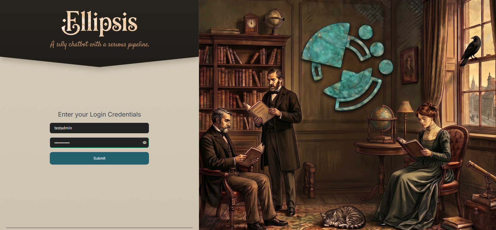
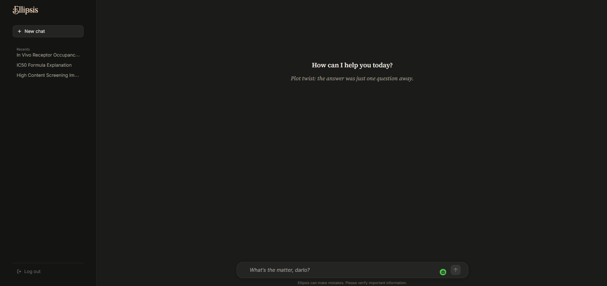
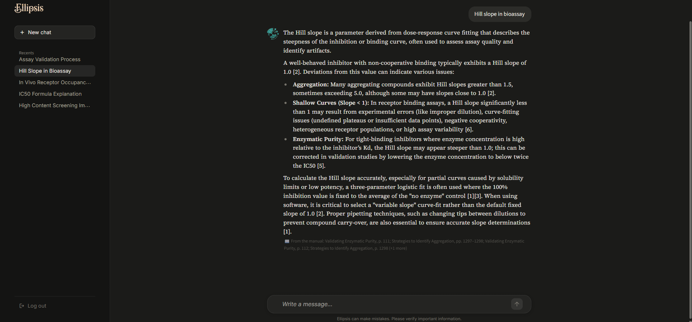

# Streamlit interface and screenshots

The Streamlit `app.py`- a heavily customised user experience with embedded CSS. 

## 1. Login / authentication

*Figure 1 — Ellipsis branding, “A silly chatbot with a serious pipeline.” tagline, username/password fields, password visibility control, submit button and split-screen illustration.*

Source-side `authenticate_user()` queries `APP_USERS` by lowercase email and checks PBKDF2-SHA256 password hashes using constant-time comparison. UI session persistence uses a signed authentication cookie.

## 2. Chat home screen

*Figure 2 — Dark UI with Ellipsis logo, New chat, recent conversations, logout control, welcome message, chat composer and notice to verify important information.*

The code implements conversation history from Oracle and stores per-user pin/order metadata in a local `chat_prefs.json` file. 

## 3. Cited answer view

*Figure 3 — Answer to “Hill slope in bioassay” with assistant text, in-text numbered references and source sections/page ranges.*

The screenshot shows the presentation layer of the RAG pipeline.
