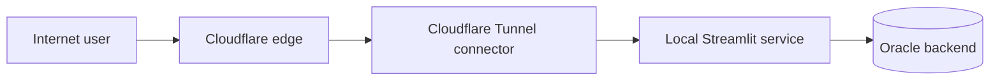

# Cloudflare Tunnel

**Deployment method:** Cloudflare Tunnel enables a public hostname to reach a Streamlit instance running behind a private network boundary through outbound `cloudflared` connections.



## Illustrative tunnel routing

```yaml
# public hostname: heyellipsis.in
# service: http://127.0.0.1:8501
```
